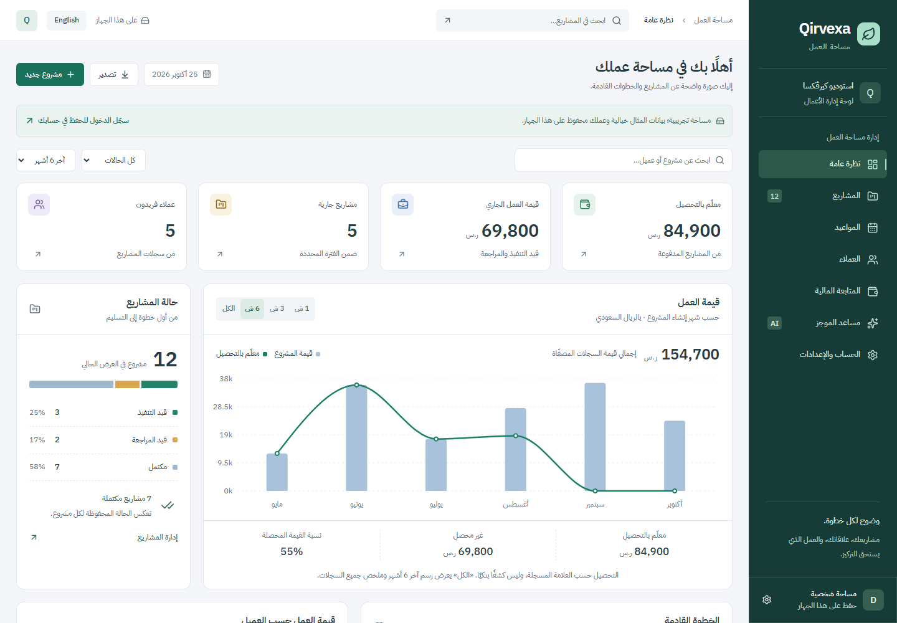

# Qirvexa

<div dir="rtl" align="right">تحديث25أكتوبر2026: لوحة عمل بترتيب مستلهم من Velzon، بهوية خضراء مستقلة: قائمة جانبية وشريط علوي وبحث سريع، ملخصات من السجلات، رسم مركب للقيمة والتحصيل، حالة المشاريع، المواعيد القادمة، قيم العملاء، وتقدم المهام في الجدول. جميع الأزرار تقود لوظائف فعلية. الحركة قصيرة وتدعم تقليل الحركة. اجتاز المصدر25اختبارًا، و54حالة تجاوب، وفحوص الفترة والبحث والمسودات ولوحة المفاتيح والتباين؛ تدقيق Webforge النهائي99 دون ملاحظات وصول عالية. تفاصيل التنفيذ والمراجعة في CHANGELOG وREVIEW.</div>

25 October 2026: a Velzon-inspired operational layout in Qirvexa's own forest identity. Compact navigation/topbar and working quick search, record-derived summaries, a composed value/paid chart, project status, upcoming work, client values and real task progress. Short functional motion respects reduced-motion settings. Build,25 unit tests,54 responsive cases and period/search/draft/keyboard/contrast fixtures passed; final Webforge audit99 has no high accessibility findings. Existing large JavaScript bundle warning remains a performance limitation, not a field-performance certification.
<div dir="rtl" align="right">مساحة لإدارة المشاريع والمهام والعملاء والمواعيد، مع متابعة القيم والمدفوع والمستحق ومساعد ذكي للموجزات. صفحات المشاريع قابلة للمشاركة كرابط داخل مساحة الحساب، وبيانات كل حساب خاصة به. الضيف يحفظ على جهازه. راجع سجل التغييرات والمراجعة لتفاصيل توسعة 24 أكتوبر 2026.</div>

A bilingual project workspace with tasks, client profiles, deadlines, recorded-value finances and AI briefs. Per-project deep links resolve within the current owner's workspace; they do not expose private records publicly. Guest state is device-local. See CHANGELOG and REVIEW for the 2026-10-24 upgrade and verification.

[](https://github.com/abomosaa/qirvexa/actions/workflows/ci.yml)

<div dir="rtl" align="right">

لوحة إدارة مشاريع ثنائية اللغة، بالعربية أولًا، مع أداة لتحويل فكرة قصيرة إلى موجز قابل للتعديل. مشروع معرض أعمال بهوية وبيانات خيالية؛ لا تمثل الأرقام إيرادات أو عملاء حقيقيين.

إضافة المشاريع وتعديلها وحذفها، تغيير الحالة والسداد، البحث والتصفية، تصدير CSV، ملخص العملاء ورسوم مشتقة من السجلات المعروضة. يحفظ وضع الضيف التغييرات على هذا الجهاز، ولا يرفعها تسجيل الدخول تلقائيًا.

اجتازت فحوص البناء والمنطق وتجربة الضيف التحقق. طُبّق مخطط Supabase وفُحص عزل المستخدمين. نُشر التطبيق وعمل توليد AI فعلي بالعربية عبر واجهته المنشورة في 21 أكتوبر 2026. في 23 أكتوبر تأكد تسجيل دخول Google فعلي وحفظ مشروع سحابي وتعديله وبقاؤه بعد إعادة التحميل. Google مفعّل وGitHub معطّل. نماذج البريد وكلمة المرور باللغتين موجودة؛ إنشاء الحساب واستعادة الكلمة بالبريد يظلان محجوبين، إذ تعطل إعداد Brevo عند التحقق عبر SMS وأُجّل لحين مراجعة الدعم. المثال الجاهز للذكاء الاصطناعي منفصل وموسوم بأنه مكتوب مسبقًا.

</div>

An Arabic-first, bilingual project dashboard with an editable brief assistant. This portfolio prototype uses fictional identity and records. Project CRUD, status/paid tracking, search/date filters, derived charts, CSV export, client rollup, settings, and saved briefs are implemented. Guest data persists on the device and is not automatically uploaded on sign-in.

Supabase schema and ownership checks are verified. Public deployment and real Arabic AI generation through the published interface were verified on 2026-10-21. On 2026-10-23, a real Google sign-in and cloud project create/edit/reload flow were verified in Qirvexa. Google is enabled; optional GitHub is disabled. Email/password forms are implemented in Arabic/English, but public signup/reset delivery remains gated: Brevo setup is blocked at SMS verification and deferred pending support. The prewritten AI sample is separately labeled.

[Live demo / العرض المباشر](https://qirvexa.qirvexa.workers.dev) · [Source / المصدر](https://github.com/abomosaa/qirvexa)



## Run / التشغيل

Use Node.js compatible with Vite 8, then:

```sh
npm ci
npm run dev
```

Vite serves the interface and local demo. It has no Worker API. To exercise `/api/brief`, build and run Wrangler:

```sh
npm run build
npm run dev:worker
```

Cloudflare AI requires an authorized account/binding. A health response proves binding presence, not completed inference.

## Configuration / الإعداد

Copy `.env.example` to ignored `.env.local`. Set `VITE_SUPABASE_URL` and `VITE_SUPABASE_PUBLISHABLE_KEY`; never put a service-role key in the frontend. Rebuild after changing Vite variables.

Email/password sign-in is available for confirmed accounts. Keep `VITE_EMAIL_DELIVERY_ENABLED=false` until custom SMTP confirmation/recovery delivery has been tested; only email-dependent signup/reset controls are gated. Email confirmation remains enabled. Google/GitHub availability comes from public Auth settings, with no frontend OAuth secrets. See [authentication setup](supabase/AUTH.md), [database setup](supabase/README.md) and [schema](supabase/schema.sql).

Google's audience remains **Testing**, without a brand-verification or In Production claim. Google's [basic identity exception](https://support.google.com/cloud/answer/15549945?hl=en) permits identity-only sign-in without adding users to the test list. The shared Supabase redirect allowlist now has six exact entries, including both demos' bare and trailing-slash origins and recovery URLs. Tavoryxa's real Google sign-in and simulated cloud-order reload passed after that callback fix.

The Worker uses `@cf/meta/llama-3.1-8b-instruct-fp8`, with 750 output tokens, a 2,000-character idea limit, a 12,000-byte streamed-body cap, same-origin checks, and five requests per IP per minute. Failures return explicit errors; the prewritten sample never substitutes for model output.

## Verification / التحقق

```sh
npm run typecheck
npm test
npm run build
```

Recorded: 19 passing Vitest tests (business data, Worker boundaries and auth/recovery safeguards), browser guest CRUD/status/paid/reload/sample-save checks, mocked auth-race isolation in `qa/auth-isolation.cjs`, and form/provider/recovery scenarios in `qa/auth-forms.cjs`. Auth screens have no page overflow at 390/820/1440px. Browser auth fixtures create no real users and send no email. See [REVIEW.md](REVIEW.md) for scope and open checks.

The 2026-10-23 live Google check began with an empty cloud workspace, confirming guest records were not imported. A fictional 1,200 SAR project was created, changed to review, and persisted after reload. Loading sample records concurrently preserved that project. Signing out returned to Demo visitor; searching for the new cloud project returned zero guest matches. This documentation update did not rerun the historical 19-test/build packet.

## Reuse / إعادة الاستخدام

React, TypeScript, Vite, Recharts, Lucide, self-hosted IBM Plex fonts, Supabase, and a Cloudflare Worker. Use [DESIGN.md](DESIGN.md) for visual extensions, [PRODUCT.md](PRODUCT.md) for product constraints, and [CHANGELOG.md](CHANGELOG.md) for history. Replace fictional data before real use. This is a published portfolio demo, not a production accounting service. GitHub Actions validates tests/builds; cloud deployment is manual with `npm run build` then `npm run deploy` after authenticating Wrangler.
