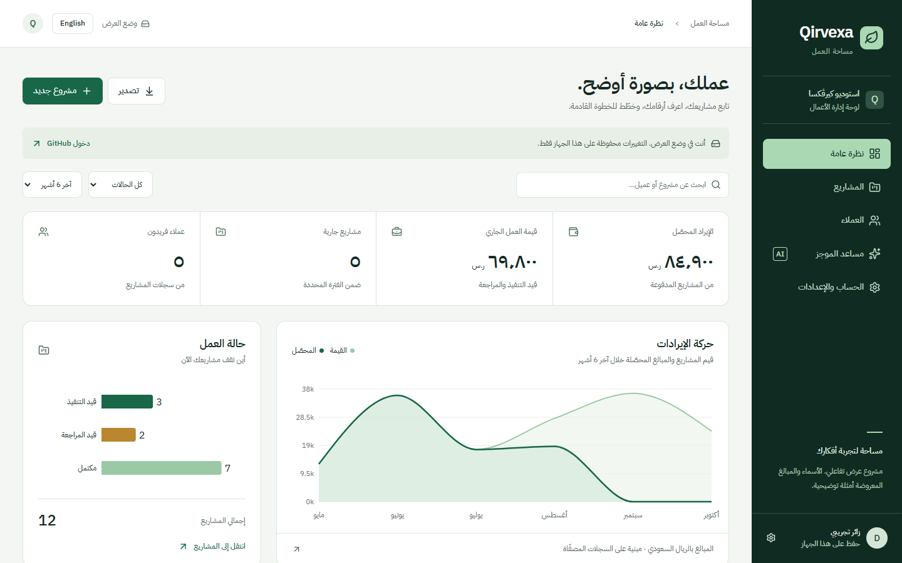

# Review / تقرير المراجعة

## Authentication update — 2026-10-22 / تحديث الحسابات

Implemented email/password sign-in, signup/confirmation, forgot-password, verified-owner password recovery and configured Google/GitHub actions. `VITE_EMAIL_DELIVERY_ENABLED` remains false until real delivery tests. No live Google/email round trip is claimed. / نُفذت نماذج الحسابات والمزودين، مع إبقاء بوابة البريد معطلة حتى اختبار الإرسال الحقيقي.

Passed: 19 unit tests, frontend build/typecheck, Worker typecheck, isolated `qa/auth-forms.cjs`, and prior `qa/auth-isolation.cjs`. The form packet checks provider flags, spoofed recovery URL, safe errors, signup confirmation/duplicate lock, reset redirect and a fixed-owner recovery write during account switching. All browser credentials/responses are fixtures; no real user/mail/cloud writes are made. New auth captures at 390/820/1440px have no horizontal overflow. / الاختبارات معزولة دون حسابات حقيقية أو إرسال بريد، وفُحص تجاوب النماذج دون تجاوز أفقي.

A fresh reviewer found that singleton `updateUser()` could read a different tab's current session. The recovery mutation now captures the verified owner's bearer before dispatch and the reviewer marked this finding resolved. Impeccable reports advisory palette/type documentation drift; its pre-existing sidecar was not repaired as a side effect of this feature. / أُصلح تبديل الحساب أثناء الاستعادة وأكد المراجع الحل. تنبيهات توثيق الألوان والخطوط إرشادية ولم يُعاد بناء ملف التصميم الجانبي ضمن هذه الميزة.

حالة 21 أكتوبر 2026: عرض منشور مع مخطط سحابي مطبّق ومختبر. اختُبر توليد موجز عربي فعلي من الواجهة المنشورة، إضافة إلى اختبارات Worker المعزولة. عزل البيانات لا يثبت اكتمال دخول GitHub؛ تفعيل مقدم الخدمة ما زال معلقًا.

Snapshot: 2026-10-21. Recorded implementation evidence and remaining external checks:

| Area            | Evidence                                                                                                          | Limit                                                                          |
| --------------- | ----------------------------------------------------------------------------------------------------------------- | ------------------------------------------------------------------------------ |
| Build           | Build and typecheck passed                                                                                        | Local build, not production launch                                             |
| Tests           | 12 Vitest tests passed: six business-data, six Worker boundary                                                    | AI/bindings stubbed                                                            |
| Guest browser   | Create, edit, status + paid, reload, delete, sample-brief save passed                                             | Device-local mode                                                              |
| Auth races      | `qa/auth-isolation.cjs` passed stale-response/account-switch checks                                               | Mocked browser auth, no real OAuth round trip                                  |
| Responsive      | No horizontal page overflow at 390/820/1440px                                                                     | Representative widths                                                          |
| Webforge        | Latest score 99 overall; no high accessibility issues                                                             | Arabic skip-link finding was a false positive; not accessibility certification |
| Impeccable      | Manual detector findings `[]`                                                                                     | Tool metric, not full certification                                            |
| Database        | Both migrations applied to Supabase `ieyjlrgehdhsapnmvyvp`; security advisors `[]`                                | GitHub provider flow still unverified                                          |
| Ownership       | Rollback-transaction assertions passed owner reads and cross-user project/order isolation                         | Database boundary checks, not full cloud sessions                              |
| Shared checkout | Fake unit price ignored; notebook quantity 2 = 14,800 halalas; idempotence and negative-quantity rejection passed | Tavoryxa RPC evidence, not a Qirvexa purchase feature                          |

Public deployment: https://qirvexa.qirvexa.workers.dev . The main agent verified actual Arabic model output through the published UI, plus a direct authenticated Cloudflare API call recorded in `qa/live-ai.json`. Health alone was not used as proof of inference. Open: configure and verify the visitor GitHub OAuth provider/redirects. Social metadata is intentionally minimal.

Fresh visual review inspected desktop/tablet/mobile images. Its one finding was a missing small-screen chart legend. The legend was restored, the same two screenshots were recaptured, and the reviewer scored that finding resolved; this is a narrow visual verdict, not certification of every application state. / راجع وكيل مستقل الصور وطلب إبقاء دليل ألوان الرسم على الشاشات الصغيرة. أُصلح ذلك وأُعيد التصوير، وأكد المراجع حل ملاحظته ضمن هذا النطاق.

The Worker limits output to 750 tokens, ideas to 2,000 characters, streamed bodies to 12,000 bytes, and requests to five per IP/minute. It fails explicitly. Vite has no API; Worker testing needs `npm run build` then `npm run dev:worker`.

Guest data remains local and is not uploaded on sign-in. All sample clients, amounts, and the ready-made brief are fictional. Portfolio/CV copy may describe this published prototype and its verified AI integration; real visitor authentication still needs the open provider checks. This evidence does not establish readiness for production accounting.
